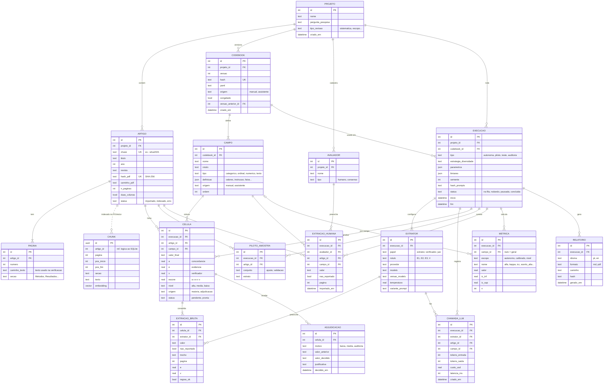
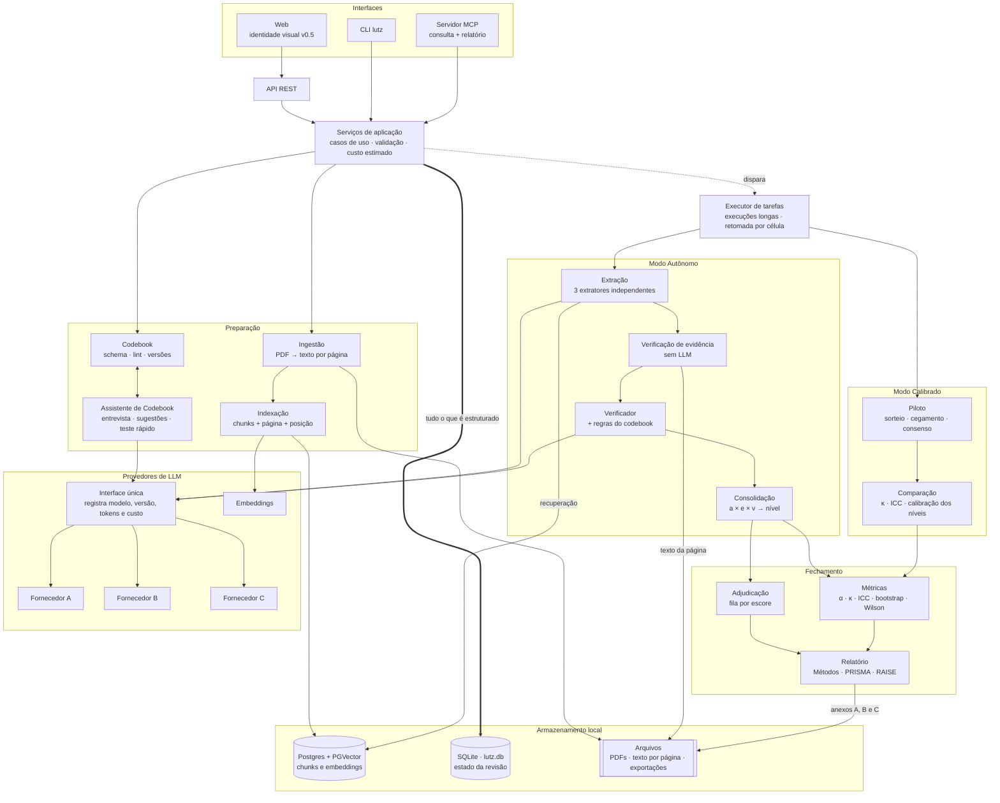

Lutz 2.0 · base: Especificação do sistema

# Modelo de dados e arquitetura

Dois diagramas em Mermaid derivados das seções 2 e 5 da spec. O código-fonte de cada um está abaixo do desenho, pronto pra copiar pro repositório ou pra um README.

## Modelo entidade-relacionamento

Um arquivo `lutz.db` (SQLite) por projeto. A entidade `CHUNK` mora no PGVector e se liga ao SQLite só por referência lógica (linha tracejada).

||--o{ um para zero ou muitos

||--|{ um para um ou muitos

PK / FK / UK chave primária, estrangeira, única



Diagrama largo: role para o lado dentro do quadro.

### EXTRATOR

Na spec, o extrator era só uma coluna. Virou tabela pra guardar papel (extrator, verificador, juiz), provedor, modelo, versão exata e variante de prompt de cada um. É daí que sai a estratégia de diversidade do relatório.

### CHAMADA_LLM

Uma linha por chamada, com tokens e custo. Sustenta o rastreamento de uso da v0.5 e a estimativa de custo antes de cada extração.

### CELULA antes das brutas

A célula é criada como `pendente` e as extrações brutas apontam pra ela. Isso deixa a retomada idempotente: o executor só processa células que não estão prontas.

### AVALIADOR "consenso"

O padrão-ouro do piloto é gravado como um avaliador do tipo `consenso`. Assim a comparação Lutz × humano e Lutz × padrão-ouro usa a mesma tabela.

### METRICA com campo nulo

Com `campo_id` preenchido, guarda α, κ e ICC por campo. Nulo, guarda métricas gerais, como a taxa de acerto de cada nível de confiança.

### Nada é apagado

Cada execução gera linhas novas e o codebook aponta pra versão anterior. O histórico inteiro fica auditável, como a spec pede.

Código Mermaid do modelo ER

```
erDiagram
    PROJETO ||--o{ ARTIGO : contem
    PROJETO ||--o{ CODEBOOK : versiona
    PROJETO ||--o{ AVALIADOR : cadastra
    PROJETO ||--o{ EXECUCAO : roda
    ARTIGO ||--|{ PAGINA : tem
    ARTIGO ||..o{ CHUNK : "indexado no PGVector"
    CODEBOOK ||--|{ CAMPO : define
    CODEBOOK ||--o{ EXECUCAO : "usado em"
    EXECUCAO ||--|{ EXTRATOR : configura
    EXECUCAO ||--o{ CHAMADA_LLM : registra
    EXECUCAO ||--o{ CELULA : produz
    EXECUCAO ||--o{ PILOTO_AMOSTRA : sorteia
    EXECUCAO ||--o{ EXTRACAO_HUMANA : recebe
    EXECUCAO ||--o{ METRICA : calcula
    EXECUCAO ||--o{ RELATORIO : gera
    ARTIGO ||--o{ CELULA : "linha"
    CAMPO ||--o{ CELULA : "coluna"
    CELULA ||--|{ EXTRACAO_BRUTA : consolida
    EXTRATOR ||--o{ EXTRACAO_BRUTA : preenche
    EXTRATOR ||--o{ CHAMADA_LLM : faz
    CELULA ||--o{ ADJUDICACAO : recebe
    ARTIGO ||--o{ PILOTO_AMOSTRA : sorteado
    AVALIADOR ||--o{ EXTRACAO_HUMANA : preenche
    ARTIGO ||--o{ EXTRACAO_HUMANA : ""
    CAMPO ||--o{ EXTRACAO_HUMANA : ""
    CAMPO |o--o{ METRICA : "por campo"

    PROJETO {
        int id PK
        text nome
        text pergunta_pesquisa
        text tipo_revisao "sistematica, escopo..."
        datetime criado_em
    }
    ARTIGO {
        int id PK
        int projeto_id FK
        text chave UK "ex.: silva2021"
        text titulo
        int ano
        text revista
        text hash_pdf UK "SHA-256"
        text caminho_pdf
        int n_paginas
        bool duas_colunas
        text status "importado, indexado, erro"
    }
    PAGINA {
        int id PK
        int artigo_id FK
        int numero
        text caminho_texto "texto usado na verificacao"
        text secao "Metodos, Resultados..."
    }
    CHUNK {
        uuid id PK
        int artigo_id "ref. logica ao SQLite"
        int pagina
        int pos_inicio
        int pos_fim
        text secao
        text texto
        vector embedding
    }
    CODEBOOK {
        int id PK
        int projeto_id FK
        int versao
        text hash UK
        text yaml
        text origem "manual, assistente"
        bool congelado
        int versao_anterior_id FK
        datetime criado_em
    }
    CAMPO {
        int id PK
        int codebook_id FK
        text nome
        text rotulo
        text tipo "categorico, ordinal, numerico, texto"
        json definicao "valores, instrucao, faixa..."
        text origem "manual, assistente"
        int ordem
    }
    EXECUCAO {
        int id PK
        int projeto_id FK
        int codebook_id FK
        text tipo "autonoma, piloto, teste, auditoria"
        text estrategia_diversidade
        json parametros
        json limiares
        int semente
        text hash_prompts
        text status "na fila, rodando, pausada, concluida"
        datetime inicio
        datetime fim
    }
    EXTRATOR {
        int id PK
        int execucao_id FK
        text papel "extrator, verificador, juiz"
        text rotulo "E1, E2, E3, V"
        text provedor
        text modelo
        text versao_modelo
        real temperatura
        text variante_prompt
    }
    CHAMADA_LLM {
        int id PK
        int execucao_id FK
        int extrator_id FK
        int artigo_id FK
        int campo_id FK
        int tokens_entrada
        int tokens_saida
        real custo_usd
        int latencia_ms
        datetime criado_em
    }
    CELULA {
        int id PK
        int execucao_id FK
        int artigo_id FK
        int campo_id FK
        text valor_final
        real a "concordancia"
        real e "evidencia"
        real v "verificador"
        real escore "a x e x v"
        text nivel "alta, media, baixa"
        text origem "maioria, adjudicacao"
        text status "pendente, pronta"
    }
    EXTRACAO_BRUTA {
        int id PK
        int celula_id FK
        int extrator_id FK
        text valor
        bool nao_reportado
        text trecho
        int pagina
        real e
        real v
        bool regras_ok
    }
    ADJUDICACAO {
        int id PK
        int celula_id FK
        text motivo "baixa, media, auditoria"
        text valor_anterior
        text valor_decidido
        text justificativa
        datetime decidido_em
    }
    AVALIADOR {
        int id PK
        int projeto_id FK
        text nome
        text tipo "humano, consenso"
    }
    PILOTO_AMOSTRA {
        int id PK
        int execucao_id FK
        int artigo_id FK
        text conjunto "ajuste, validacao"
        text estrato
    }
    EXTRACAO_HUMANA {
        int id PK
        int execucao_id FK
        int avaliador_id FK
        int artigo_id FK
        int campo_id FK
        text valor
        bool nao_reportado
        int pagina
        datetime importado_em
    }
    METRICA {
        int id PK
        int execucao_id FK
        int campo_id FK "nulo = geral"
        text escopo "autonomo, calibrado, nivel"
        text nome "alfa, kappa, icc, acerto_alta..."
        real valor
        real ic_inf
        real ic_sup
        int n
    }
    RELATORIO {
        int id PK
        int execucao_id FK
        text idioma "pt, en"
        text formato "md, pdf"
        text caminho
        text hash
        datetime gerado_em
    }
```

## Arquitetura da aplicação

Quatro portas de entrada para um único núcleo em Python. Execuções longas passam por um executor de tarefas; tudo o que é estruturado vai pro SQLite, e o PGVector cuida só da recuperação semântica.



### Web pela API, CLI e MCP direto

A interface web consome a API REST. CLI e servidor MCP chamam a mesma camada de serviços no próprio processo, sem passar por HTTP.

### Executor de tarefas

A spec pede execuções assíncronas com retomada. Sugestão minha: começar com um worker em processo separado que lê a tabela `EXECUCAO` como fila, sem Redis nem Celery, pra manter tudo local.

### Verificação sem LLM

A checagem de evidência lê o texto da página no sistema de arquivos, nunca o chunk. Por isso a seta vai pra Arquivos, e não pro PGVector.

### Leitura do desenho

O Mermaid prende algumas setas na borda dos blocos. A seta que chega em "Provedores de LLM" vem do Assistente, da Extração e do Verificador.

Código Mermaid da arquitetura

```
flowchart TB
    subgraph UI["Interfaces"]
        direction LR
        WEB["Web<br/>identidade visual v0.5"]
        CLI["CLI lutz"]
        MCP["Servidor MCP<br/>consulta + relatório"]
    end

    API["API REST"]
    APP["Serviços de aplicação<br/>casos de uso · validação · custo estimado"]
    JOBS["Executor de tarefas<br/>execuções longas · retomada por célula"]

    WEB --> API --> APP
    CLI --> APP
    MCP --> APP
    APP -. "dispara" .-> JOBS

    subgraph PREP["Preparação"]
        direction LR
        ING["Ingestão<br/>PDF → texto por página"]
        IDX["Indexação<br/>chunks + página + posição"]
        CB["Codebook<br/>schema · lint · versões"]
        AST["Assistente de Codebook<br/>entrevista · sugestões · teste rápido"]
    end

    subgraph AUTO["Modo Autônomo"]
        direction LR
        EXT["Extração<br/>3 extratores independentes"]
        EVI["Verificação de evidência<br/>sem LLM"]
        VER["Verificador<br/>+ regras do codebook"]
        CON["Consolidação<br/>a × e × v → nível"]
    end

    subgraph CAL["Modo Calibrado"]
        direction LR
        PIL["Piloto<br/>sorteio · cegamento · consenso"]
        CMP["Comparação<br/>κ · ICC · calibração dos níveis"]
    end

    subgraph POS["Fechamento"]
        direction LR
        ADJ["Adjudicação<br/>fila por escore"]
        MET["Métricas<br/>α · κ · ICC · bootstrap · Wilson"]
        REL["Relatório<br/>Métodos · PRISMA · RAISE"]
    end

    APP --> ING & CB
    JOBS --> EXT & PIL
    ING --> IDX
    CB <--> AST
    EXT --> EVI --> VER --> CON
    PIL --> CMP
    CON --> ADJ & MET
    CMP --> MET
    ADJ --> REL
    MET --> REL

    subgraph LLM["Provedores de LLM"]
        direction LR
        GW["Interface única<br/>registra modelo, versão, tokens e custo"]
        PA["Fornecedor A"]
        PB["Fornecedor B"]
        PC["Fornecedor C"]
        EMB["Embeddings"]
        GW --> PA & PB & PC
    end

    AST --> GW
    EXT --> GW
    VER --> GW
    IDX --> EMB

    subgraph DATA["Armazenamento local"]
        direction LR
        PG[("Postgres + PGVector<br/>chunks e embeddings")]
        SQ[("SQLite · lutz.db<br/>estado da revisão")]
        FS[["Arquivos<br/>PDFs · texto por página · exportações"]]
    end

    IDX --> PG
    EXT -- "recuperação" --> PG
    ING --> FS
    EVI -- "texto da página" --> FS
    REL -- "anexos A, B e C" --> FS
    APP == "tudo o que é estruturado" ==> SQ
```